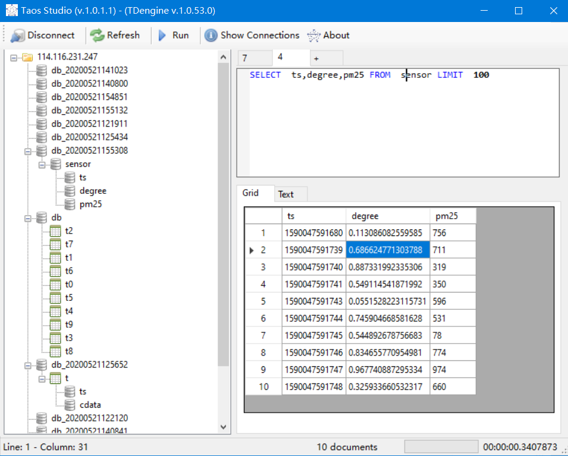
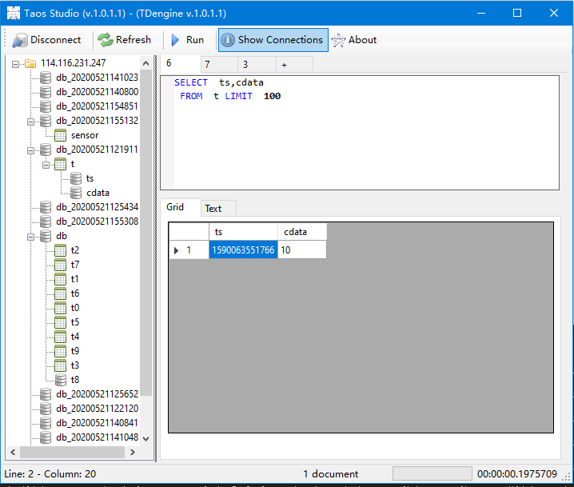

# [Taos.Studio](http://taos.studio/)

A GUI tool for viewing   data  for TDengine

## Apache IoTDB

The connection dialog can connect to Apache IoTDB 2.x through its REST API and
select the Tree or Table model. Enter either a host and port (the default REST
port is `18080`) or an HTTP/HTTPS base URL. REST API suffixes are normalized
before the client appends the model-specific API path. Credentials are sent
with HTTP Basic Authentication.

Tree SQL query statements use `/rest/v1/query`; other statements use
`/rest/v1/nonQuery`. Table statements use `/rest/table/v1/query` or
`/rest/table/v1/nonQuery` and include the selected database in the request.
Results are shown in the existing grid and are limited to 64 MiB per HTTP
response. The database explorer lists Tree timeseries or Table tables according
to the selected model; SQL remains available for operations supported by the
connected server.

The integration targets IoTDB 2.x REST v1 Tree and Table endpoints. The exact
IoTDB server release and data model of the deployment must be checked before
production use; automated contract tests use mocked HTTP responses, and live
server validation remains outstanding.

- Gitee https://gitee.com/maikebing/Taos.Studio 
   
- GitHub https://github.com/maikebing/Taos.Studio

 
 - Maikebing.EntityFrameworkCore.Taos   https://gitee.com/maikebing/Maikebing.EntityFrameworkCore.Taos
 
   
